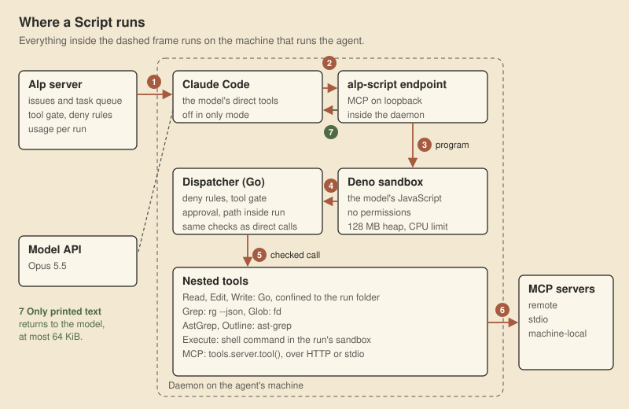
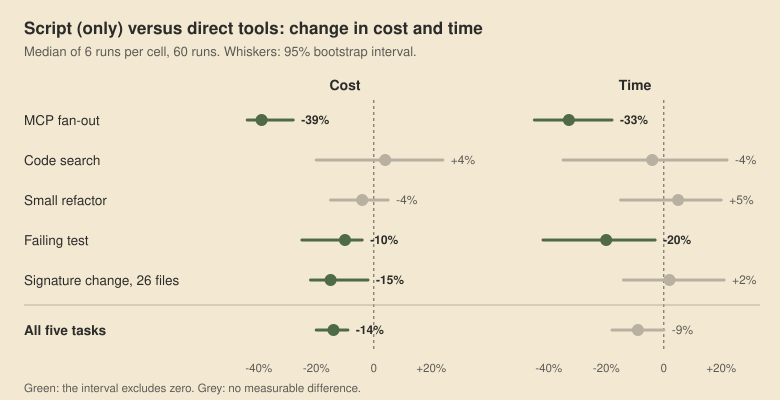

The first measurement said the new tool made our agent 64% faster and 22% cheaper.

It was wrong. The direct-tool runs we were comparing against were not slow because they called tools one by one. They were slow because one shell command in them waited two minutes for input that never came. Once that was fixed, the rerun with four tasks gave 14% faster and 9% cheaper. Measured again with sixty runs and confidence intervals, the answer was 9% cheaper and about 9% faster across five tasks, the time saving at the edge of what six runs per task can show. Almost all of the gain came from one kind of work.

This post is about that tool, the Script tool in [Alp](/alp/), and about the two days of measuring it. The tool turned out to be the easy part.

## One request per round of tool calls

An agent works in a loop. The model asks for tool calls, the harness runs them, the results go back into the conversation, and the model is asked again. Every round trip is a new model request, and every request carries the whole conversation so far.

That is fine for a few rounds. It is expensive for work shaped like this: list 32 support tickets, read each one, read the customer behind each, filter, add up hours per region. Done with direct tool calls, that took 9 model requests in our measurement. The model emits a batch of calls, waits, reads every ticket in full, emits the next batch. All 32 tickets end up in the context, and every later request pays for them again.

The idea is not new. It goes back at least to [CodeAct](https://arxiv.org/abs/2402.01030), and both [Cloudflare](https://blog.cloudflare.com/code-mode/) and [Anthropic](https://www.anthropic.com/engineering/code-execution-with-mcp) have written about it for MCP; the Claude API ships it as [programmatic tool calling](https://platform.claude.com/docs/en/agents-and-tools/tool-use/programmatic-tool-calling). Give the model one tool that takes a program, and let the program call the other tools. Loops, filters and sums happen in code. Only what the program prints goes back to the model.

In Alp the tool is called Script. The model writes JavaScript, and every tool the agent has is a function on `tools`. This is the program the model wrote in one of our measured runs, shortened but with its error handling kept:

```js
const parse = v => JSON.parse(typeof v === "string" ? v : v.map(b => b.text || "").join(""));
const ids = parse(await tools.helpdesk.list_tickets({}));

const got = await Promise.allSettled(ids.map(id => tools.helpdesk.get_ticket({ id: String(id) })));
const tickets = [];
got.forEach((r, i) => r.status === "fulfilled"
  ? tickets.push(parse(r.value))
  : text(`ticket ${ids[i]} failed: ${r.reason}`));

const cids = [...new Set(tickets.map(t => t.customer_id))];
const cs = await Promise.allSettled(cids.map(id => tools.helpdesk.get_customer({ id: String(id) })));
const cust = {};
cs.forEach((r, i) => r.status === "fulfilled"
  ? (cust[cids[i]] = parse(r.value))
  : text(`customer ${cids[i]} failed: ${r.reason}`));

const sum = { EU: 0, NA: 0, APAC: 0 }; let n = 0;
for (const t of tickets) {
  const c = cust[t.customer_id];
  if (!c) { text(`no customer for ${t.id}`); continue; }
  if (["open", "pending"].includes(t.status) && c.tier === "enterprise") { sum[c.region] += t.hours_open; n++; }
}
text(JSON.stringify({ sum, n }));
```

One tool call, 43 MCP calls inside it, in three parallel waves: the list, then all 32 tickets at once, then the 10 customers those tickets belong to at once. The model never saw a ticket. It saw `{"sum":{"EU":651,"NA":813,"APAC":0},"n":14}`. A failed call would have been printed rather than silently dropped; whether the answer was right was checked separately, as it was for every run.

<figure>
  
  <figcaption>Figure 1. Two real runs from round 3, same task, model and build, each close to the median of its group.</figcaption>
</figure>

With direct tools, the 32 `get_ticket` calls arrive in two batches of 16, each batch a model round trip, and the model then reads the 9 customers it needs. With Script, the second request is the model writing the program, about 11 seconds of output. The program then makes all 43 calls in less than a second, and two more short requests post the answer.

## The architecture

<figure>
  
  <figcaption>Figure 2. Everything inside the dashed frame runs on the machine that runs the agent.</figcaption>
</figure>

Alp runs agents through a daemon on the machine that does the work: a developer's laptop, a shared worker, a microVM. The server never runs a Script.

- **The endpoint.** The daemon serves an MCP endpoint called `alp-script` on loopback, with a secret path per run. Claude Code sees it as one more MCP server with two tools, `Script` and `WaitForScript`.
- **The sandbox.** The program runs in Deno, a version pinned and checked by SHA-256 when it is downloaded. It runs with no permissions at all: no network, no file system, no environment, no imports. A 128 MB heap, a resident memory cap and a CPU time limit stop a runaway loop. The only thing the program can do is call `tools`.
- **The dispatcher.** Every `tools.X(...)` call leaves Deno as a line of JSON on standard output, with a per-run token, and comes back the same way. The Go side decides it exactly as it would decide the direct call it stands for: the agent's deny rules, the workspace tool gate, a person's approval if the gate asks for one, and a check that every path stays inside the run's folder. A refused call is an error inside the program. It never waits silently.
- **The nested tools.** Read, Edit and Write are Go code. Grep is ripgrep with JSON output, so the program gets typed records instead of text to parse. Glob is fd. AstGrep and Outline are ast-grep. Execute runs a shell command inside the same sandbox the run's own shell uses. Every MCP server the agent has, remote or local, becomes `tools.<server>.<tool>()`.
- **The way back.** Only what the program prints with `text()` or `console.log()` goes back to the model, at most 64 KiB per Script. Anything longer is cut in the middle and the full output goes to a log file in the run folder. Every answer ends with a status line, such as `[Script completed · 43 calls]`.

The model sees the bindings as TypeScript declarations in the tool description, generated from each tool's input schema. MCP tools come first, so a client that cuts long descriptions cuts the built-in part, which the model knows anyway.

### Three modes

Each agent has a setting: `off`, `on` or `only`.

- `off`: direct tools only.
- `on`: Script next to the direct tools; the prompt steers any step of more than two calls into a Script.
- `only`: Script replaces the direct tools. Claude Code is started with Read, Edit, Write, Grep, Glob and Bash disallowed, and the MCP servers the Script owns are removed from its own configuration, so a result cannot come back the long way.

The `only` mode works only on Claude Code, because it is the only CLI we run whose direct tools can be switched off from outside. For the other CLIs, `only` falls back to `on`. Private Teams chats and side chats never get Script; their rules are simpler without it.

## The real flow of one run

This is what happens when a person assigns an issue to an agent whose mode is `only`:

1. The server puts a task in the queue. The daemon on the agent's machine claims it, together with the workspace's run settings.
2. The daemon prepares the folder. The agent's stable brief goes into a system prompt file, passed with `--append-system-prompt-file`, so every run of that agent starts with the same cacheable prefix. Run-specific parts go into the folder's `CLAUDE.md`.
3. The daemon decides the mode, checks that Deno can run `text(1 + 1)`, and starts the `alp-script` endpoint. If any of that fails, the run falls back to `off`.
4. Claude Code starts with its direct tools disallowed and one MCP server added. Every shell command it would have run, including Alp's own CLI, now runs as `tools.Execute(...)` inside a Script.
5. The model calls Script. The program runs, every nested call is checked and executed, and the printed result comes back with the status line.
6. A Script that runs longer than five minutes keeps running. The model gets an id and can wait for it, check on it or kill it. When the turn ends, every Script still running is stopped.
7. The run ends. Token usage per model goes to the server, along with prompt cache figures for the run: the share of the first request read from cache, the share of the whole run, and how many times the cache broke. Nested calls appear in the transcript under the Script call that made them.

## How we measured

We did not want a benchmark. We wanted to know what changes for the agents we run every day, so we measured the product itself.

- **The real product.** Runs started the way any run starts: create an issue, assign it to an agent. Each agent was a real Alp agent on a real daemon, with its real folder, tools and sandbox. The only difference between two agents was the Script setting.
- **Tasks with one right answer.** Every task ends in a line such as `ANSWER: EU=651;NA=813;APAC=0;N=14`, or in a check script that runs the tests and compares the files. A run counts only if it is right.
- **Five tasks.** An MCP fan-out over a small helpdesk server (32 tickets, 12 customers). Three counts in a clone of the ripgrep repository. A rename plus a new function in a small Go module. A failing test whose cause is two files away. A signature change across 26 files and 64 call sites, with traps: an import alias, calls split over lines, look-alike functions in other packages, the same text in comments and strings. Every package's test records the arguments of each call, so a careless rewrite fails.
- **Every request recorded twice.** A small proxy between Claude Code and the API wrote down the usage of every request. Alp records the same numbers itself. In 59 of 60 runs they matched to the token; the sixtieth lost its row when we redeployed the backend mid-run, and we took it from the proxy.
- **Cost at API list price.** Opus 5.5 input at $4 and output at $20 per million tokens, cache reads at 0.05x input, cache writes at 2x input. Every cache write in these runs had a one-hour lifetime, which is what the 2x is for. We run on subscriptions, so this is not a bill. It is a measure of how much model work a run takes, which is also what wears down a subscription's limits. Time is the run's start to its end.
- **Intervals, not anecdotes.** Six runs per task and mode, run by two agents in parallel, each in random order. For every comparison we resampled the runs 10,000 times and report the 95% interval of the change in the median. If the interval crosses zero, we say there is no measurable difference.
- **Hangs counted.** Any tool call over 60 seconds, or a gap over 120 seconds inside a run, is flagged. That rule is what we did not have the first time.

## Five rounds

<figure>
  
  <figcaption>Figure 3. The comparison of rounds 1 to 3: Claude with Script in <code>only</code> mode against direct tools, sum of task medians.</figcaption>
</figure>

**Round 0, a stub server.** Before touching the product, we tried the idea outside it: a fake ticket server, Claude Code started by hand, two task types. Script came out far ahead on the ticket tasks and 7% more expensive on a file-and-shell task. A review the same day found that our first metric counted every loop iteration as a saved call and priced cache reads at full input price. We kept the direction and dropped the number.

The stub runs taught us one thing that held up. Our first prompt said "one Script per step". The model obeyed, and split each job into two or three Scripts. Changed to "put the whole job in as few Scripts as possible, chain dependent steps", it wrote one Script and finished each stub task in two requests. Over nine runs (three tasks, three runs each) the total time went from 142 seconds to 93. In the product, the same task takes four or five requests, because the agent also reads its issue and posts its answer.

**Round 1, the real product, three CLIs, 66 runs.** Eight agents: Claude Code, Codex and Grok, with Script `off`, `on` and `only` (Grok without `only`). Each ran three tasks: the ticket fan-out and the ripgrep counts three times, the Go refactor twice. That is 64 runs, plus two Claude runs that replaced two that hung. For Claude, `only` against `off` said 22% cheaper and 64% faster.

The 64% came from one task. In the Go refactor, the median direct-tool run took 173 seconds against Script's 36. Reading the transcripts showed why: the model had run `rg CalcTotal` with no path. Claude Code gave the shell an open socket as standard input, ripgrep with no path reads standard input, and the call sat there until the two-minute timeout. Four of the six Claude runs of that task that had a direct shell hit it: both `off` runs, which are in that 173-second median, and two of the `on` runs, which hung for good because the CLI never sent its final result while the stuck command lived. Those two are not in any median; they are the ones we replaced.

Commands inside a Script never had that socket, so Script runs did not hit it. The 64% measured our bug, not the tool. The fix was one line at the top of every run's shell environment: `exec </dev/null`.

The other two CLIs were clearer. Codex, given Script next to its direct tools, did not call it once in eight runs. Given only Script, it got one total wrong (it added up the raw output in its head), made quoting mistakes when it wrapped shell commands in JavaScript, and cost twice as much on the Go refactor (+103%). Grok found the tool but could not see the typed declarations, guessed the function names, and spent its first few Scripts on errors; one run wrote a Rust lexer inside a Script, ran for 20 minutes and returned the wrong count. We switched Script on for Claude models only.

**Round 2, Claude, hang fixed, 24 runs.** The same three tasks plus the failing test, three runs each per mode. 9% cheaper and 14% faster overall, almost all of it from the ticket task. The refactor that had been 79% faster was now equal.

**Round 3, Claude, 60 runs with intervals.** Five tasks, six runs each, Script in `only` mode against direct tools. This is the result we use.

<figure>
  
  <figcaption>Figure 4. Round 3. Green: the interval excludes zero.</figcaption>
</figure>

| Task | Cost, direct → Script [95% interval] | Time, direct → Script [95% interval] | Model requests |
|---|---|---|---|
| MCP fan-out | $0.408 → $0.278, **-32%** [-36, -24] | 48 s → 32 s, **-33%** [-45, -18] | 9 → 4.5 |
| Code search | +4% [-15, +26] | -4% [-35, +22] | 7 → 6 |
| Small refactor | -1% [-8, +5] | +5% [-15, +20] | 8 → 6.5 |
| Failing test | $0.298 → $0.284, **-5%** [-16, -1] | 43 s → 34.5 s, **-20%** [-42, -3] | 8 → 6 |
| Signature change, 26 files | $0.553 → $0.510, -8% [-15, +4] | +2% [-14, +21] | 11 → 7 |
| All five | $1.907 → $1.731, **-9%** [-14, -4] | 267 s → 244 s, -9% [-18, 0] | |

Bold: the interval excludes zero. All 60 runs were right. No task got measurably worse. The time saving overall touches zero, so "about 9% faster" is as far as these runs go.

Output tokens were the same in both modes; the whole saving is on the input side, from fewer requests each carrying less. Script does not make fewer tool calls. The Script runs of the ticket task made 42 to 87 MCP calls each, some fetching every ticket twice, against 42 for the direct runs. What it cuts is model requests.

**Round 4, the language server.** We had installed language servers on every agent machine. Twelve more runs asked whether telling the model to use one helps on the 26-file signature change. It did not: 8% more expensive, inside the noise, same time. Told to use it, the model called `findReferences` once in four of six runs and got the right 65 references, the 64 call sites plus the declaration. Then it wrote its own program with Go's parser anyway and counted with that. Not told, it never opened the language server: in none of the 6 runs here and none of the 60 runs of round 3. We kept the servers and did not add a line about them to any agent's instructions.

## What the model actually does

We gave Script typed Grep, Glob, Outline and AstGrep bindings, and expected the model to use them in code work. In the 30 Script runs of round 3, the Grep binding was used zero times. Outline zero. AstGrep in three runs.

What the model did instead was run the same shell tools it uses with direct tools, ripgrep and fd, through `tools.Execute`, several at once. For the signature change it wrote its own `go/ast` program in all twelve runs, with and without Script, and all twelve were right. In code work, Script is mostly a way to put several shell commands into one request. On the failing test that was worth 5% of cost and a fifth of the time; on a search the model can already do with one pipeline, it was worth nothing.

## What the measurements found

Measuring the product meant every bug in the product showed up in the numbers. Most of the two days went into these:

- **The shell that waited for input.** Described above. One line, every run.
- **Keep-warm requests that failed.** After a chat turn, Alp sends a tiny request shortly before the prompt cache expires, so the next message does not pay to write the whole conversation again. 16% of them failed: the sandbox could not find the run's temporary folder, because the run had already removed it. They now recreate it for their own lifetime.
- **Keep-warm requests that missed the cache.** A keep-warm request starts a new CLI process, which lists its tools again. After a turn, the Script endpoint was closed or served a default list, so the tool list differed from the turn's and the cache prefix broke. An idle endpoint now keeps answering with the last list.
- **A user's settings inside an agent's run.** On a developer machine, the daemon's runs picked up the developer's own shell aliases, CLI instructions and skills list. In the direct-tool run in Figure 1, the model's first attempt to write its reply fails with `command not found: bat`, because the developer has aliased `cat` to it. The skills list alone was 28 KB in every request. Runs can now be isolated from user settings.
- **Usage that disappeared.** A cancelled run wrote no usage at all, although the proxy saw 24 requests. A run open during a backend deploy lost its usage row; that one we saw in round 3.
- **A cost of zero.** Alp showed every run as free: prices were missing for two models, and one CLI reported its model as "unknown". Every dollar figure in this post comes from our measurement scripts, not from the product.
- **Our own price.** The first version of this post priced Opus 5.5 cache reads at 0.1x input and cache writes at 1.25x. The right numbers for this model and this cache lifetime are 0.05x and 2x. Alp's own price table had the right cache-read price; our measurement scripts did not. Because 86 to 93% of every request is read from cache, the error moved every dollar figure. The overall saving went from 14% to 9%, and the signature change from a measurable 15% to an 8% that is not.

## The prompt cache

<figure>
  
  <figcaption>Figure 5. The first request of a run is where the cache matters most: everything after it is mostly read.</figcaption>
</figure>

Script saves requests. The prompt cache decides what each remaining request costs, and on a subscription it decides how long the limits last. Inside a run the cache was already doing its job: 86 to 93% of input read from cache, and no breaks in the 66 runs of round 1. Between runs it was not.

The first request of every run read only 29% from cache, because the agent's brief sat in the first user message under a path that changed every run. Moving the stable part into the system prompt raised that to 50%. The rest is still written fresh: the run's folder path, the issue, and the environment block the CLI builds.

For chats, the subscription writes the cache with a one-hour lifetime. A keep-warm request at 59.4 minutes read 42,000 tokens and wrote 314, and the next message, 62 minutes after the last, read 95% from cache. Without it, that message would have written the whole conversation again at twice the input price, instead of reading it at a twentieth.

Every run now reports its own cache figures, and a request that reads less than 80% of the previous request's input is logged as a break. We stopped guessing whether the cache works.

## Where it leaves us

Script is on for Claude agents, in `only` mode, as the workspace default: the workspace's Script model list is `claude-*`. For Codex and Grok it is off.

What to expect from it, from our own numbers: a third less cost and a third less time on MCP fan-out, the shape of work our data agents do. On a failing test, 5% less cost and a fifth less time. On searches, small refactors and a 26-file signature change, nothing we can tell from noise with six runs. Across five mixed tasks, 9% less cost.

What we do not know yet:

- **Real work.** These are five tasks. We scanned 4,674 interactive agent sessions on our own machines for stretches where the agent called an API several times in a row, the shape Script compresses best. They were 3.8% of requests, because the models already batch such calls into one shell command. The large savings belong to agents that fan out over data, and we have not yet measured them on their real traffic. The usage data to do that is now correct.
- **Small effects.** Six runs per cell cannot separate small effects on code tasks from noise. The intervals in the table are 13 to 41 points wide; anything inside them is unmeasured, not absent.
- **The unused bindings.** Typed Grep, Outline and AstGrep are not used. Either their descriptions should steer the model, measured in a separate round, or they should go.
- **Other models.** Codex and Grok were measured once, with few runs, in the round that had the bug. Their results may have been different without it.

## Methodology

- Product: Alp's test deployment, the build of that day for each round; daemon on a shared development machine; Claude Code 2.1.
- Model: `claude-opus-5-5` in every Claude run of rounds 1 to 4, checked from the usage records. Round 1 also used Codex (`gpt-6.1-sol`, reasoning xhigh) and Grok (`grok-4.7`).
- Runs: round 1, 66 (plus a pilot); round 2, 24; round 3, 60; round 4, 12. In rounds 2 to 4, two agents ran in parallel on the same subscription account, each running its jobs one at a time in random order; in round 1, eight agents.
- Correctness: a fixed answer line or a check script per task. All runs of rounds 2 to 4 were correct.
- Tokens and requests: a recording proxy between the CLI and the API, cross-checked against Alp's own usage records (identical in all completed runs).
- Cost: API list price for Opus 5.5, $4 / $20 per million input / output tokens, cache reads 0.05x input, one-hour cache writes 2x input. All cache writes in these runs were one-hour writes, as recorded by the proxy. Prices for Codex and Grok in round 1 were assumed from earlier models of the same family.
- Statistics: median per task and mode; bootstrap resampling of runs within each cell, 10,000 repeats; 95% intervals for the change in the median; the overall row is the change in the sum of task medians.
- Limits: two arms shared one account, so absolute times depend on load. The backend was redeployed once during round 3; both runs open at that moment completed correctly.
